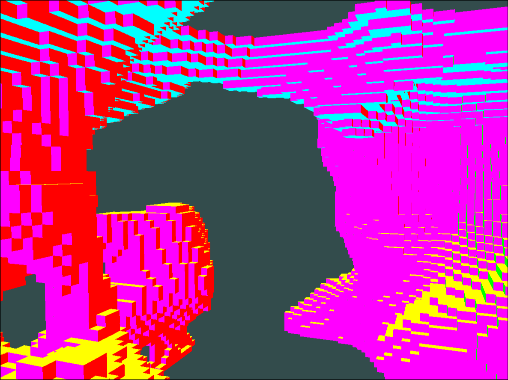

# RUNEBIND
Welcome to the repo for my game runebind. In runebind you explore different cave systems in search for ruïnes with runes in them. You can combine runes at base camp to make spells to defeat enemies easier and explore faster. 
The game is still in very active development and full of bugs so be were. So far the only systems that have been completed are the generation of the cave map and the height map. 
The game is written in c++ and uses Opengl and GLM to render and calculate the voxel layout I choose to use with the game. Voxels where a good choice as you do a lot of customization with them while still keeping a blocky style which I like.
To try out the cave generation for yourself download the repo and run the CaveGeneration file.
## Testing Cave Generation V2

1. Download the files in this repo, make sure you have all the needed libraries (glm, glew and opengl, fastnoiselite) in your include folder
2. Unzip the files and go into the folder
3. Build the graphics file
   **Linux**
   ```Bash
   g++ -g -std=c++17 graphics.cpp -o graphics -lGLEW -lglfw -lGL
   ./graphics
   ```
## Testing Cave Generation V3

This generation I am momentarily building and testing makes a long corridor which later I will add branching corridors and caverns to. This gives the players a "set path" to explore instead of a large cave like structure which was gen 2. The aim is to also automate the placement of ruins throughout the cave for players to explore.
1. Download the files in this repo, make sure you have all the needed libraries (glm, glew and opengl, fastnoiselite) in your include folder
2. Unzip the file and go into the folder
3. Build the CaveGenerationV3 file
   **Linux/MacOS** - You should be able to do the same on Windows
   ```Bash
   g++ -g -std=c++17 CaveGenerationV3.cpp -o graphics -lGLEW -lglfw -lGL
   ./graphics
   ```
## Further Development
After I finish the cave system I am going to work on getting a player and enemy system up and running. Once that works I'll start work on the main part of the game - the spell crafting. Players should be able to find runes throughout the ruins. Using these runes they can make different combinations and thus different spells.
